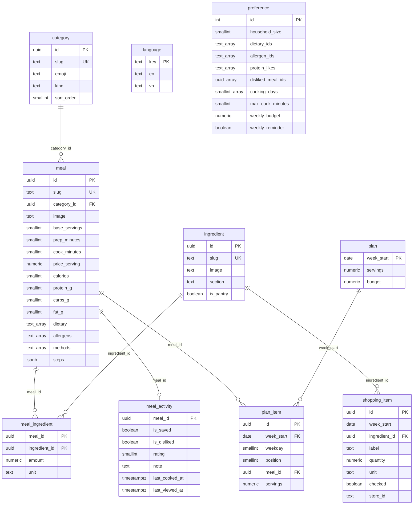

# Thiết kế database

Phạm vi: một tài khoản duy nhất, không có household / subscription / đồng bộ đa người dùng.
Chia hai tầng:

- **Catalog**: dữ liệu có sẵn, sinh ra từ `scraping-app/data`, chỉ đọc lúc chạy.
- **Runtime**: dữ liệu phát sinh khi người dùng sử dụng app.

Đánh đổi chính so với bản chi tiết: các quan hệ phụ (bước nấu, dietary, allergen, chế độ nấu) dùng cột `array`/`jsonb` trên `meal` thay vì tách bảng; không có `user_id` ở bất kỳ đâu.

## Quy ước

1. **Catalog không có cột chữ nào.** Không bảng nào có `title`, `name`, `label`. Mọi chuỗi hiển thị nằm trong `language`.
2. **`slug` của bảng catalog chính là `language.key`.** Không có cột `title_key`, không có tiền tố `meal.`/`ingredient.`. Ví dụ món `steak` → dòng `language` có `key = 'steak'`.
3. Mỗi bảng catalog giữ `id uuid` làm khóa chính kỹ thuật để join nội bộ; `slug` unique là danh tính nghiệp vụ và là khóa dịch.
4. Quy tắc suy ra khóa:

| Nội dung | Khóa trong `language` | Ví dụ |
|---|---|---|
| Tên món (`meal.slug`) | `<slug>` | `steak` |
| Tên nguyên liệu (`ingredient.slug`) | `<slug>` | `anchovies` |
| Tên danh mục / thiết bị (`category.slug`) | `<slug>` | `chicken`, `airfryer` |
| Nhóm nguyên liệu (`ingredient.section`) | `<slug>` | `produce` |
| Chế độ ăn (`meal.dietary[]`) | `<slug>` | `dairyfree` |
| Dị ứng (`meal.allergens[]`) | `<slug>` | `milk` |
| Đơn vị (`meal_ingredient.unit`) | `<slug>` | `g` |
| Bước nấu | `<slug>.step.<method>.<n>` | `steak.step.oven.3` |

Chỉ bước nấu có hậu tố — vì một món có nhiều bước, không thể dùng chung một key.

## Catalog — 5 bảng

```sql
-- Bảng duy nhất chứa chữ hiển thị. `key` là khóa chính, không có uuid.
create table language (
  key text primary key,
  en  text,
  vn  text
);

create table category (
  id         uuid primary key default gen_random_uuid(),
  slug       text not null unique,     -- 'chicken','airfryer',...
  emoji      text,                     -- không dịch
  kind       text not null default 'meal' check (kind in ('meal','method')),
  sort_order smallint not null default 0
);

create table ingredient (
  id        uuid primary key default gen_random_uuid(),
  slug      text not null unique,      -- 'anchovies'
  image     text,
  section   text,                      -- slug nhóm: 'produce','meat','dairy','pantry'
  is_pantry boolean not null default false   -- gia vị/dầu: không cho vào list mua
);

create table meal (
  id            uuid primary key default gen_random_uuid(),
  slug          text not null unique,   -- 'steak', '15minutecheeseburgerpasta'
  category_id   uuid references category(id),
  image         text,
  base_servings smallint not null default 2,
  prep_minutes  smallint not null,
  cook_minutes  smallint not null,
  price_serving numeric(10,2),          -- VND / khẩu phần
  calories      smallint,               -- per serving
  protein_g     smallint,
  carbs_g       smallint,
  fat_g         smallint,
  -- slug, không phải khóa dịch: UI tra thẳng 'language.key = slug'
  dietary       text[] not null default '{}',   -- {'dairyfree'}
  allergens     text[] not null default '{}',   -- {'milk','gluten'}
  -- slug của category có kind = 'method'
  methods       text[] not null default '{}',   -- {'hob','oven'}
  -- {"hob": [1, 2, 3], "oven": [1, 2, 3]} — số bước, UI ghép 'steak.step.hob.1'
  steps         jsonb  not null default '{}'
);

create table meal_ingredient (
  meal_id       uuid not null references meal(id) on delete cascade,
  ingredient_id uuid not null references ingredient(id),
  amount        numeric(10,3) not null,   -- cho meal.base_servings
  unit          text not null,            -- 'g','ml','tbsp','piece'
  primary key (meal_id, ingredient_id)
);
```

`meal` và `ingredient` là quan hệ nhiều-nhiều, nên bảng thứ tư là bảng nối `meal_ingredient` (công thức).

## Runtime — 5 bảng

```sql
create table preference (              -- đúng 1 dòng duy nhất
  id                int primary key default 1 check (id = 1),
  household_size    smallint not null default 2,
  dietary_ids       text[] not null default '{}',   -- slug: {'dairyfree'}
  allergen_ids      text[] not null default '{}',   -- slug: {'milk'}
  protein_likes     text[] not null default '{}',   -- slug
  disliked_meal_ids uuid[] not null default '{}',
  cooking_days      smallint[] not null default '{1,2,3,4,5}',
  max_cook_minutes  smallint,
  weekly_budget     numeric(10,2),
  weekly_reminder   boolean not null default false
);

create table meal_activity (           -- lưu / chấm điểm / ghi chú / đã nấu / xem gần đây
  meal_id        uuid primary key references meal(id) on delete cascade,
  is_saved       boolean not null default false,
  is_disliked    boolean not null default false,
  rating         smallint check (rating between 1 and 5),
  note           text,                 -- người dùng tự viết, không dịch
  last_cooked_at timestamptz,
  last_viewed_at timestamptz
);

create table plan (                    -- 1 dòng / tuần
  week_start date primary key,         -- thứ 2
  servings   numeric(4,1) not null default 2,
  budget     numeric(10,2)
);

create table plan_item (
  id         uuid primary key default gen_random_uuid(),
  week_start date not null references plan(week_start) on delete cascade,
  weekday    smallint not null check (weekday between 1 and 7),
  position   smallint not null default 0,
  meal_id    uuid not null references meal(id),
  servings   numeric(4,1) not null
);

create table shopping_item (
  id            uuid primary key default gen_random_uuid(),
  week_start    date,
  ingredient_id uuid references ingredient(id),   -- null = nhập tay
  label         text not null,                    -- chữ nhập tay; dòng từ plan để trống, đọc qua slug
  quantity      numeric(12,3),
  unit          text,
  checked       boolean not null default false,
  store_id      text                              -- id trong stores.json, không cần bảng
);
```

## Truy vấn đọc món

```sql
select m.id, m.slug, l.en, l.vn, m.image, m.calories
from meal m
join language l on l.key = m.slug;
```

## Quy tắc sinh danh sách đi chợ

```
join plan_item → meal_ingredient
quantity = meal_ingredient.amount × (plan_item.servings / meal.base_servings)
```

Bỏ qua `ingredient.is_pantry = true`, rồi upsert theo `(week_start, ingredient_id, unit)`.

## Thứ tự seed

`language` trước tất cả, rồi `category` / `ingredient`, sau đó `meal`, cuối cùng `meal_ingredient`.

## ERD



`language` đứng tách rời trong sơ đồ vì không có khóa ngoại nào trỏ tới nó: liên kết là **ngầm định qua slug**. Quan hệ thật là 1–1 giữa `meal.slug` / `ingredient.slug` / `category.slug` ↔ `language.key`, không thể vẽ bằng `erDiagram`.

Ba liên kết cũng chỉ là quy ước, không có FK: `meal.dietary[]`/`meal.allergens[]`/`meal.methods[]` → `language.key`, `ingredient.section` → `language.key`, `shopping_item.store_id` → `stores.json`.

## Những gì cố ý không đưa vào

| Bỏ | Lý do |
|---|---|
| `language.id` uuid | `key` đã là khóa chính; thêm uuid không ai tham chiếu |
| Cột `title` / `name` / `label` ở mọi bảng | Chữ nằm trong `language`, tra bằng `slug` |
| Bảng `user`, `household`, `subscription`, `push_token` | Một tài khoản, không có backend chia sẻ/thu phí |
| Bảng `store` | 129 siêu thị chỉ để hiển thị → giữ JSON tĩnh ở `App/src/features/shopping/data/stores.json` |
| Bảng `dietary`, `allergen`, `tag`, `unit`, `protein` | Chỉ là danh sách slug cố định, bản dịch đã nằm trong `language` |
| Bảng `meal_step`, `meal_cook_method` | Dùng `steps` jsonb + `methods` array |
| Bảng `translation` dạng (entity, field, locale) | `language(key, en, vn)` gom đủ, đọc 1 dòng là có cả hai ngôn ngữ |
| Bảng `subscription_event`, `join_attempt`, `swap_log` | Audit/analytics, chưa cần |
| `catalog_version` | Catalog cố định một bản; thêm sau nếu cần cập nhật từ xa |

## Hệ quả cần biết

- **Key là một không gian tên phẳng, dùng chung.** Đã kiểm tra dữ liệu scrape hiện tại: 460 meal, 177 ingredient, 129 store, 4 dietary, cùng các slug `chicken`/`beef`/`seafood`/`hob`/`oven`/`airfryer` — **không có cặp nào trùng**. Nếu lần scrape sau sinh ra nguyên liệu tên đúng bằng một món, `insert into language` sẽ nổ ngay vì `primary key (key)`: lỗi to, thấy liền lúc seed, không âm thầm lúc chạy.
- **Không có FK bảo vệ khóa dịch.** `meal.slug` không ràng buộc với `language.key`, nên món thiếu bản dịch sẽ join ra rỗng. Kiểm tra sau seed:

  ```sql
  create view missing_translation as
  select 'meal' as kind, slug from meal where slug not in (select key from language)
  union all
  select 'ingredient', slug from ingredient where slug not in (select key from language)
  union all
  select 'category', slug from category where slug not in (select key from language);
  ```

- **`slug` là dữ liệu bất biến.** Đổi slug = mất bản dịch + mất khóa bước nấu, không có gì báo lỗi.
- **Số dòng `language`**: 460 món + 177 nguyên liệu + ~7 danh mục + 4 thiết bị + 4 chế độ ăn + 9 dị ứng + ~6 đơn vị + bước nấu (~460 × 2–4 bộ × 5 bước ≈ 5.000–9.000). Tổng khoảng 6.000–10.000 dòng.
- **Thêm ngôn ngữ thứ 3 là `alter table language add column`** — với `de`, `fr`, `es`, `pt`, `nl` (app gốc có, xem FEATURES.md mục 11) thì phải thêm 5 cột. Nếu chấp nhận đánh đổi ngược (1 dòng / key / ngôn ngữ) thì đổi thành `language(key, locale, value)`.
- **Lợi ích phụ**: `ingredients.json` scrape bị lỗi chữ (`"Anchov Ies"`). Sửa một dòng `language` với `key = 'anchovies'` là xong, không phải sửa file dữ liệu nguồn.
