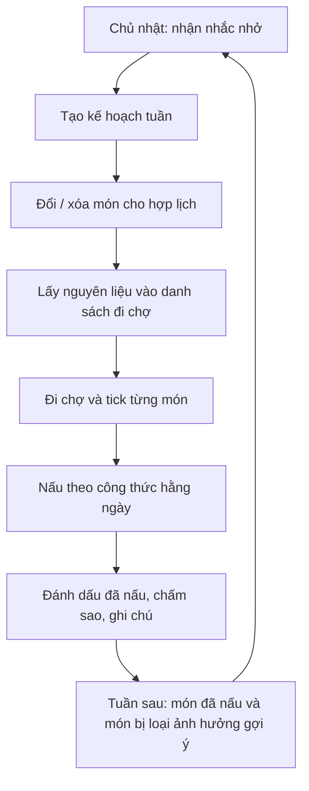

# Kịch bản người dùng

Kịch bản kể lại một người dùng đi qua app từ lần mở đầu tiên đến khi đi chợ và nấu xong. Mỗi bước ghi rõ **màn hình** (route trong `App/src`) và **bảng** trong `database-design.md` được đọc / ghi.

> Một tài khoản, một thiết bị, không có đăng nhập thật. Các màn Tài khoản, Gia đình, Premium là bản demo giao diện, không có bảng tương ứng.

## Nhân vật

**Linh, 29 tuổi**, làm văn phòng, sống cùng bạn trai. Hai người ăn tối ở nhà 5 ngày/tuần, thường mất công nghĩ "tối nay ăn gì" và đi chợ thiếu đồ. Linh bị dị ứng sữa, thích gà và hải sản, mỗi tối chỉ muốn nấu tối đa 40 phút, ngân sách 1.200.000đ/tuần.

**Mục tiêu:** có kế hoạch cả tuần, một danh sách đi chợ đúng khẩu phần, và công thức rõ ràng khi đứng bếp.

## Tổng quan hành trình

```mermaid
flowchart LR
  A[Mở app lần đầu] --> B[/onboarding]
  B --> C[/setup]
  C --> D[Tạo kế hoạch tuần]
  D --> E[/planner]
  E --> F[/meals/:id]
  E --> G[/shopping]
  G --> H[Đi chợ]
  H --> I[Nấu]
  I --> J[Đánh giá món]
  J --> E
```

---

## Kịch bản 1 — Lần đầu mở app

**Tình huống:** Linh vừa cài app, chưa có dữ liệu.

| # | Linh làm | App phản hồi | Màn hình | Bảng |
|---|---|---|---|---|
| 1 | Mở app | Router thấy chưa xem giới thiệu nên chuyển sang `/onboarding` | `/onboarding` | `preference` (đọc cờ) |
| 2 | Vuốt qua 3 slide giới thiệu, bấm **Tiếp tục** → **Bắt đầu** | Ghi nhận đã xem, chuyển sang `/setup` | `/onboarding` | — |
| 3 | Chọn **2 người** ăn | Lưu `household_size = 2`, dùng để quy đổi khẩu phần và chi phí | `/setup` bước 1 | `preference` |
| 4 | Chọn chế độ ăn (không chọn) và dị ứng **Sữa** | Lưu `allergen_ids = ['milk']`; từ giờ món có sữa không được gợi ý | `/setup` bước 2 | `preference`, `language` |
| 5 | Chọn đạm yêu thích **Gà, Hải sản**; kéo thời gian nấu tối đa **40 phút** | Lưu `protein_likes`, `max_cook_minutes = 40` | `/setup` bước 3 | `preference`, `category` |
| 6 | Chọn nấu **Thứ 2–6**, ngân sách **1.200.000đ** | Lưu `cooking_days = [1,2,3,4,5]`, `weekly_budget` | `/setup` bước 4 | `preference` |
| 7 | Bật nhắc lập kế hoạch Chủ nhật 18:00 | Lưu `weekly_reminder = true` (giao diện, chưa có thông báo thật) | `/setup` bước 5 | `preference` |
| 8 | Bấm **Tạo kế hoạch của tôi** | Màn chờ ~1 giây, sinh kế hoạch rồi mở `/planner` | `/setup` → `/planner` | xem kịch bản 2 |

**Nhánh phụ:** bấm **Bỏ qua** ở bất kỳ bước nào → vào `/home` với giá trị mặc định (2 người, 45 phút, 1.200.000đ). Thoát giữa chừng rồi mở lại sẽ quay về đúng bước đã dừng (`setupStep`).

**Mở app lần sau:** `/onboarding` và `/setup` tự chuyển về `/home`.

---

## Kịch bản 2 — Tạo và chỉnh kế hoạch tuần

**Tình huống:** Linh đang ở màn Lịch ngay sau khi thiết lập.

| # | Linh làm | App phản hồi | Màn hình | Bảng |
|---|---|---|---|---|
| 1 | Nhìn thẻ tổng quan | Hiện số món, **chi phí tuần so với ngân sách** | `/planner` | `plan`, `plan_item`, `meal` |
| 2 | Thanh chip chỉ có **T2 … CN** (chỉ hiện thứ); bấm **T4** | Cuộn tới ngày, hiện món của ngày đó | `/planner` | `plan_item` |
| 3 | Thấy món Thứ 4 không hợp, bấm **Đổi món** | Mở bảng gợi ý ứng viên đã lọc theo dị ứng, thời gian nấu, ngân sách, loại món bị đánh dấu không thích | `/planner` (bottom sheet) | `preference`, `meal`, `meal_activity` |
| 4 | Chọn một món thay thế | Thay đúng chỗ (`position` cũ), cập nhật chi phí | `/planner` | `plan_item` |
| 5 | Xóa món Thứ 6 vì hôm đó đi ăn ngoài | Bỏ dòng khỏi kế hoạch | `/planner` | `plan_item` |
| 6 | Bấm **Tạo lại kế hoạch** | Sinh bộ mới, vẫn tôn trọng sở thích | `/planner` | `plan`, `plan_item` |
| 7 | Bấm nút **Gợi ý nhanh** ở giữa thanh điều hướng | Hiện sheet gợi ý một món nhanh, thêm được vào kế hoạch | mọi tab | `meal`, `plan_item` |

**Quy tắc lọc ứng viên** (đầu vào từ `preference`):

| Điều kiện | Cột |
|---|---|
| Loại món có dị ứng | `meal.allergens` ∩ `preference.allergen_ids` |
| Chỉ lấy món đúng chế độ ăn | `meal.dietary` ⊇ `preference.dietary_ids` |
| Món không quá lâu | `prep_minutes + cook_minutes ≤ max_cook_minutes` |
| Ưu tiên đạm yêu thích | `meal.category_slug` ∈ `preference.protein_likes` |
| Không vượt ngân sách | tổng `price_serving × servings ≤ weekly_budget` |
| Loại hẳn món không thích | `preference.disliked_meal_slugs` |
| Tránh lặp món vừa nấu | `meal_activity.last_cooked_at` |

---

## Kịch bản 3 — Khám phá và xem chi tiết món

**Tình huống:** Linh muốn tìm món mới cho cuối tuần.

| # | Linh làm | App phản hồi | Màn hình | Bảng |
|---|---|---|---|---|
| 1 | Vào tab **Món ăn** | Thẻ món nổi bật, dải **xem gần đây**, lưới món | `/meals` | `meal`, `language`, `meal_activity` |
| 2 | Gõ "salmon" vào ô tìm kiếm | Lọc theo tên (`language.en/vn` qua `meal.slug`) | `/meals` | `meal`, `language` |
| 3 | Chọn chip danh mục **Hải sản** | Lọc `meal.category_slug` | `/meals` | `category` |
| 4 | Bấm trái tim ở một món | Lưu yêu thích (`is_saved = true`); vào lại bằng `/meals?filter=favorites` | `/meals` | `meal_activity` |
| 5 | Mở món **15 minute salmon gnocchi** | Chi tiết: thời gian, giá/khẩu phần, calo, protein, carb, fat; ghi `last_viewed_at` | `/meals/:id` | `meal`, `meal_activity` |
| 6 | Bấm **+ / −** ở bộ chỉnh khẩu phần | Nguyên liệu và macro nhân theo `servings / base_servings` | `/meals/:id` | `meal_ingredient`, `ingredient` |
| 7 | Chuyển tab **Lò nướng / Chảo / Nồi chiên** | Hiện các bước nấu của thiết bị đó (`steps[method]` → `language`) | `/meals/:id` | `meal.methods`, `meal.steps`, `language` |
| 8 | Bấm **Thêm vào kế hoạch**, chọn ngày | Thêm vào cuối ngày, `position` kế tiếp | `/meals/:id` → `/planner` | `plan_item` |

> Công thức, dinh dưỡng và bước nấu hiện là dữ liệu mock sinh theo tên món. App có ghi chú trên giao diện.

---

## Kịch bản 4 — Đi chợ

**Tình huống:** Chiều Chủ nhật, Linh chuẩn bị đi siêu thị.

| # | Linh làm | App phản hồi | Màn hình | Bảng |
|---|---|---|---|---|
| 1 | Ở `/planner` bấm **Đi chợ** (hoặc vào tab **Đi chợ**) | Mở danh sách | `/shopping` | `shopping_item` |
| 2 | Bấm **Lấy từ kế hoạch** | Gom nguyên liệu của mọi món trong tuần, nhân theo số người, bỏ qua gia vị/dầu (`is_pantry`), cộng dồn cùng nguyên liệu + đơn vị. Báo "Đã thêm N nguyên liệu" | `/shopping` | `plan_item`, `meal_ingredient`, `ingredient`, `shopping_item` |
| 3 | Chọn siêu thị trong danh sách có tìm kiếm (129 cửa hàng) | Hiện logo và tên, chỉ để tham khảo | `/shopping` | `shopping_item.store_id` (`stores.json`) |
| 4 | Bấm **Chọn từ danh sách nguyên liệu** | Mở danh mục 177 nguyên liệu có ảnh, thêm món còn thiếu | `/ingredients` | `ingredient`, `language` |
| 5 | Gõ "giấy ăn" vào ô thêm nhanh | Thêm dòng nhập tay (không có `ingredient_slug`, dùng `label`) | `/shopping` | `shopping_item` |
| 6 | Bấm **Sao chép** | Chép các món chưa mua vào clipboard để gửi bạn trai | `/shopping` | `shopping_item` |
| 7 | Đứng ở quầy, tick từng món | Thanh tiến độ "Đã mua x/y", món đã mua chìm xuống cuối và mờ đi | `/shopping` | `shopping_item.checked` |
| 8 | Bấm **Xóa đã mua** | Dọn các dòng đã tick | `/shopping` | `shopping_item` |

Mỗi dòng có ảnh nguyên liệu bên cạnh tên; dòng nhập tay không khớp nguyên liệu nào hiện icon củ cà rốt. Biểu tượng giỏ ở thanh điều hướng có **huy hiệu số món chưa mua**.

**Điểm quan trọng:** danh sách đi chợ là bản chụp đã gom, không sinh lại từ kế hoạch mỗi lần mở. Linh sửa tay thoải mái mà không bị ghi đè; chỉ khi bấm lại **Lấy từ kế hoạch** thì món chưa có mới được thêm.

---

## Kịch bản 5 — Nấu và đánh giá

**Tình huống:** Tối Thứ 2, Linh đứng bếp.

| # | Linh làm | App phản hồi | Màn hình | Bảng |
|---|---|---|---|---|
| 1 | Mở **Trang chủ** | Lời chào, món hôm nay trong kế hoạch, lối tắt | `/home` | `plan_item`, `meal` |
| 2 | Bấm vào món hôm nay | Mở chi tiết với đúng khẩu phần của kế hoạch | `/meals/:id` | `plan_item`, `meal` |
| 3 | Chọn **Nồi chiên không dầu** và làm theo từng bước | Hiện các bước thiết bị đó | `/meals/:id` | `meal.steps`, `language` |
| 4 | Nấu xong, bấm **Đã nấu** | Ghi `last_cooked_at`; món sẽ không bị gợi ý lặp lại sớm | `/meals/:id` | `meal_activity` |
| 5 | Chấm **4 sao**, viết ghi chú "bớt muối" | Lưu `rating`, `note` | `/meals/:id` | `meal_activity` |
| 6 | Một món khác không hợp khẩu vị: bấm **Không thích** | `is_disliked = true`; món bị loại khỏi các lần tạo kế hoạch sau | `/meals/:id` | `meal_activity` → `preference.disliked_meal_slugs` |

---

## Kịch bản 6 — Đổi sở thích giữa chừng

**Tình huống:** Bạn trai của Linh đi công tác, tuần này chỉ nấu cho 1 người và muốn ăn kiêng không gluten.

| # | Linh làm | App phản hồi | Màn hình | Bảng |
|---|---|---|---|---|
| 1 | Vào **Cài đặt** từ biểu tượng ở trang chủ | Hub: sở thích, gia đình, tài khoản, Premium, đặt lại dữ liệu | `/settings` | — |
| 2 | Chọn **Sở thích ăn uống** | Mở lại toàn bộ trường đã nhập ở bước thiết lập | `/preferences` | `preference` |
| 3 | Đổi số người thành 1, thêm dị ứng **Gluten** | Lưu ngay | `/preferences` | `preference` |
| 4 | Quay lại Lịch, bấm **Tạo lại kế hoạch** | Kế hoạch mới theo sở thích mới; chi phí tính cho 1 người | `/planner` | `plan`, `plan_item` |
| 5 | Mở lại Đi chợ, bấm **Lấy từ kế hoạch** | Thêm nguyên liệu của món mới | `/shopping` | `shopping_item` |

---

## Kịch bản 7 — Các màn demo

Các màn này có giao diện đầy đủ nhưng không có backend, và **không nằm trong database**:

| Màn | Hành vi hiện tại |
|---|---|
| `/account` | Đăng nhập demo, không có xác thực thật |
| `/household` | Tạo / tham gia gia đình bằng mã, dữ liệu mock |
| `/premium` | Chọn gói dùng thử, không thanh toán |
| Nhắc lập kế hoạch | Lưu cờ `weekly_reminder`, chưa gửi thông báo |
| **Đặt lại dữ liệu** (trong Cài đặt) | Xóa kế hoạch, danh sách đi chợ, yêu thích, hoạt động, sở thích; người dùng quay lại `/onboarding` |

---

## Ma trận: chức năng ↔ màn hình ↔ bảng

| Chức năng | Màn hình | Đọc | Ghi |
|---|---|---|---|
| Giới thiệu, thiết lập | `/onboarding`, `/setup` | `language` | `preference` |
| Duyệt, tìm, lọc món | `/meals` | `meal`, `category`, `language`, `meal_activity` | — |
| Yêu thích, xem gần đây | `/meals` | `meal_activity` | `meal_activity` |
| Chi tiết món, công thức, bước nấu | `/meals/:id` | `meal`, `meal_ingredient`, `ingredient`, `language` | `meal_activity` |
| Chấm sao, ghi chú, đã nấu, không thích | `/meals/:id` | `meal_activity` | `meal_activity`, `preference` |
| Tạo / đổi / xóa món trong kế hoạch | `/planner` | `preference`, `meal`, `plan_item` | `plan`, `plan_item` |
| Gợi ý nhanh | thanh điều hướng | `preference`, `meal` | `plan_item` |
| Gom và quản lý danh sách đi chợ | `/shopping` | `plan_item`, `meal_ingredient`, `ingredient` | `shopping_item` |
| Danh mục nguyên liệu | `/ingredients` | `ingredient`, `language` | `shopping_item` |
| Sở thích ăn uống | `/preferences` | `preference` | `preference` |
| Đặt lại dữ liệu | `/settings` | — | tất cả bảng runtime |

## Vòng lặp hằng tuần



## Tiêu chí kiểm tra (acceptance)

- Người dùng mới đi từ `/onboarding` đến một kế hoạch tuần có món trong không quá 5 bước thiết lập, và có thể bỏ qua.
- Kế hoạch **không bao giờ** chứa món có chất gây dị ứng đã chọn.
- Tổng chi phí tuần hiển thị so với ngân sách; vượt ngân sách thì có cảnh báo.
- Đổi khẩu phần làm thay đổi cả nguyên liệu, macro và chi phí tương ứng.
- Danh sách đi chợ cộng dồn cùng nguyên liệu + đơn vị, bỏ gia vị/dầu, không bị sinh lại đè lên chỉnh sửa tay.
- Đóng và mở lại app: kế hoạch, danh sách đi chợ, yêu thích, đánh giá và sở thích vẫn còn.
- Thiếu bản dịch (`language`) của một món không làm vỡ giao diện.

## Việc chưa có (ngoài phạm vi hiện tại)

- Thông báo nhắc thật (cần plugin Capacitor Local Notifications).
- Công thức, dinh dưỡng và bước nấu thật thay cho mock; nạp từ `master.db` do toolkit sinh ra.
- Đa ngôn ngữ ngoài `en` / `vn`; vùng theo mã bưu chính.
- Đồng bộ nhiều thiết bị, chia sẻ gia đình, thanh toán Premium.
